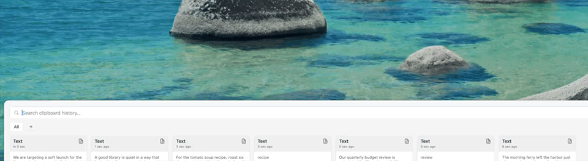

# Magpaste

Magpaste is a clipboard app for macOS only. It runs on Apple Macs with macOS 14 or later. There is no Windows, Linux, iOS, or iPadOS version.

It keeps a searchable history of what you copy and pastes any past clip back with one click. Menu-bar only. Tracks the system clipboard, saves history to disk, and shows it as a color-coded card panel docked to any screen edge. Themed after the Eurasian magpie (near-white base, silvery-blue wing sheen, bronze-green tail sheen).

## Demo

The clip shows the panel sliding in with seven copied clips, a new section being created from the `+` pill, and a card being pinned. Idle moments are sped up 2.5x. The clip is 14 seconds long.

- Full quality video (MP4, 6 MB): [`docs/demo/magpaste-demo.mp4`](docs/demo/magpaste-demo.mp4)

## Download and use

No prebuilt release exists yet. You build it from source. It takes about 2 minutes.

### Download

1. Install Xcode from the Mac App Store. Open it once and accept the license.
2. Clone the repo:
   `git clone https://github.com/sulsira/magpaste.git`
3. Or click **Code → Download ZIP** on the GitHub page and unzip it.

### Build and install

1. Open `Magpaste/Magpaste.xcodeproj` in Xcode.
2. Pick the **Magpaste** scheme and **My Mac** as the destination.
3. In **Signing & Capabilities**, choose your own Team. A free Apple ID works.
4. Press **Product → Archive**, then **Distribute App → Copy App**.
5. Drag `Magpaste.app` into `/Applications`.
6. Right-click the app → **Open** on first launch. The app is not notarized, so macOS warns you.

For a quick try without installing, press **Run (`⌘R`)** in Xcode instead of steps 4 to 6.

### First launch

1. Look for the clipboard icon in the menu bar. There is no Dock icon.
2. Open **System Settings → Privacy & Security → Accessibility** and enable **Magpaste**. Without it, clips are copied but not auto-pasted.
3. Copy some text.
4. Press the global shortcut (default in `KeyCombo.swift:12`) or click the menu-bar icon.
5. Click a card to paste it into the app you were using.

More detail is in the sections below.

## What it does

1. Polls `NSPasteboard.general` every 0.5s (`ClipboardMonitor.swift:57`).
2. Classifies each new copy as text, URL, or hex color (`ClipboardMonitor.swift:87`).
3. Saves the last 500 clips to `~/Library/Application Support/Magpaste/history.json` (`ClipboardHistoryStore.swift`).
4. Opens a panel on a global shortcut (default in `KeyCombo.swift:12`) or a menu-bar click.
5. Pastes the chosen clip into the app you were last using by simulating `⌘V` (`PasteExecutor.swift`).

## Features

| Feature | Detail | Source |
|---|---|---|
| Clipboard history | Text, URL, hex color. Skips exact repeats of the latest clip. Max 500. | `ClipboardMonitor.swift` |
| Persistence | History and sections saved as JSON, restored on launch. | `ClipboardHistoryStore.swift`, `SectionStore.swift` |
| Search | Live filter on clip content. | `ContentView.swift:23` |
| Pinning | Pinned clips sort first, then newest first. | `ContentView.swift:34` |
| Sections | User-made named, colored groups. Drag a card onto a pill to file it. Right-click a pill to rename, recolor, or delete. Deleting a section keeps its clips. | `SectionManager.swift`, `SectionEditorView.swift` |
| Multi-select | `⇧`-click or `⇧`+arrows for a range. `⌘`-click toggles one card. `Return` pastes all selected, joined by newlines. | `ContentView.swift:299` |
| Keyboard | Arrows move selection. `Return` pastes. `Delete` removes selected (search field empty). `Esc` closes. | `ContentView.swift:62`, `HistoryPanel.swift:150` |
| Dock edge | Panel slides in from left, right, top, or bottom of the screen under the cursor. Left/right is a card column. Top/bottom is a card row. | `HistoryPanel.swift`, `PanelEdge.swift` |
| Custom shortcut | Record a new global shortcut (needs `⌘`, `⌥`, or `⌃`). Uses Carbon `RegisterEventHotKey`. | `HotKeyManager.swift`, `ShortcutRecorder.swift` |
| Privacy | Ignores copies from Keychain Access, 1Password, LastPass. | `ClipboardMonitor.swift:26` |

## Requirements

- macOS 14.0 or later (`project.yml:5`).
- Xcode with Swift 5.
- Optional: [XcodeGen](https://github.com/yonaskolb/XcodeGen) to regenerate the project from `project.yml`.

## Build and test

### Build in Xcode

1. Open `Magpaste/Magpaste.xcodeproj` in Xcode.
2. Press **Run (`⌘R`)**.
3. Look for the clipboard icon in the menu bar. There is no Dock icon and no window on launch (`LSUIElement` is `true`, `project.yml:22`).

### Build from the command line

1. Run from the repo root:
   `xcodebuild -project Magpaste/Magpaste.xcodeproj -scheme Magpaste -configuration Debug -derivedDataPath build/dd build CODE_SIGNING_ALLOWED=NO`
2. Expect `** BUILD SUCCEEDED **` as the last line.
3. The app lands in `build/dd/Build/Products/Debug/Magpaste.app`.
4. Launch it with `open build/dd/Build/Products/Debug/Magpaste.app`.

If `xcodebuild` says the license is not accepted, open Xcode once and click **Agree**, or run `sudo xcodebuild -license accept`.
If it says it needs Xcode, run `sudo xcode-select -s /Applications/Xcode.app/Contents/Developer`.

### Quick type check (no Xcode project needed)

1. Run inside `Magpaste/`:
   `swiftc -typecheck -target arm64-apple-macos14.0 *.swift`
2. The only expected error is the `#Preview` macro in `ContentView.swift` and `SettingsView.swift`. It needs Xcode's plugin. Any other error is real.

### Test

There is no automated test target yet (`project.yml` defines only the app target). Test by hand:

| # | Step | Expected |
|---|---|---|
| 1 | Launch the app | Clipboard icon appears in the menu bar. No Dock icon. |
| 2 | Copy text, then a URL, then `#3B82F6` | Three cards, typed text, link, color. |
| 3 | Press the global shortcut | Panel slides in from the docked edge. |
| 4 | Type in the search field | Cards filter live. |
| 5 | Click a card in another app's text field | Text is pasted (needs Accessibility). |
| 6 | Pin a card | It moves to the front. |
| 7 | Add a section, drag a card onto it | Card shows under that section pill. |
| 8 | `⇧`-click two cards, press `Return` | Both paste, one per line. |
| 9 | Quit and relaunch | History and sections are restored. |
| 10 | Preferences → change dock edge | Panel opens from the new edge. |

Adding a unit test target for `ClipboardMonitor` classification and the stores is a good first contribution.

To regenerate the project after adding or removing files:

1. Run `xcodegen` inside `Magpaste/`.
2. It reads `project.yml` and rewrites `Magpaste.xcodeproj`.

### Accessibility permission

Pasting simulates `⌘V`, which needs Accessibility access.

1. Open **System Settings → Privacy & Security → Accessibility**.
2. Enable **Magpaste**. Run it once from Xcode first so it appears in the list.

Without it, the clip is still copied to the clipboard. You paste manually.

### Install as a standalone app

1. **Product → Archive** in Xcode.
2. In the Organizer, **Distribute App → Copy App**.
3. Drag `Magpaste.app` into `/Applications`.
4. The app is not notarized. On first launch, right-click → **Open**.
5. Optional: add it under **System Settings → General → Login Items**.

## Usage

1. Copy some text, a URL, or a hex color such as `#3B82F6`.
2. Press the global shortcut, or click the menu-bar icon. The panel opens.
3. Type to search.
4. Click a card to paste it into the previous app.
5. Hover a card and click the pin icon to pin it.
6. Click `+` in the pill row to add a section. Drag cards onto its pill.
7. Right-click the menu-bar icon → **Preferences…** to change the shortcut or the dock edge.

## Project layout

All source is in `Magpaste/`.

| Area | Files |
|---|---|
| App entry, menu bar | `MagpasteApp.swift` |
| Panel window | `HistoryPanel.swift`, `PanelEdge.swift`, `PanelEdgeManager.swift`, `PanelEdgeStore.swift` |
| UI | `ContentView.swift`, `ClipboardItemCard.swift`, `SectionEditorView.swift`, `SettingsView.swift` |
| Theme | `MagpasteTheme.swift` |
| Clipboard | `ClipboardMonitor.swift`, `ClipboardItem.swift`, `ClipboardHistoryStore.swift`, `PasteExecutor.swift` |
| Sections | `Section.swift`, `SectionManager.swift`, `SectionStore.swift` |
| Shortcut | `HotKeyManager.swift`, `KeyCombo.swift`, `KeyComboStore.swift`, `ShortcutRecorder.swift` |
| Build config | `project.yml`, `Magpaste.xcodeproj` |

## Stored data

| Data | Location |
|---|---|
| Clip history | `~/Library/Application Support/Magpaste/history.json` |
| Sections | `~/Library/Application Support/Magpaste/sections.json` |
| Shortcut | `UserDefaults` (`KeyComboStore.swift`) |
| Dock edge | `UserDefaults`, key `Magpaste.panelEdge` (`PanelEdgeStore.swift:5`) |

History is stored as plain text with no encryption.

## Color theme

The panel is light and low-contrast so it sits quietly on the desktop.

| Role | Hex |
|---|---|
| Panel background | `#F4F5F7` |
| Card background | `#FFFFFF` |
| Wing blue (links, primary accent) | `#4A85B8` |
| Tail green (pins, secondary accent) | `#2E9670` |
| Neutral tint (plain text clips) | `#EEEFF1` |

New sections get a random color from an 8-color palette (`MagpasteTheme.swift`).

## Known gaps

- Image clips: `ClipboardItemType.image` exists but the monitor only reads strings (`ClipboardMonitor.swift:95`).
- The card footer shows `⌘1` to `⌘9` labels (`ClipboardItemCard.swift:26`). No key handler for them was found in the source.
- The ignore list is hardcoded (`ClipboardMonitor.swift:26`). No UI to edit it.
- No retention setting. The cap is fixed at 500.
- `ClipboardItem.mockData` is unused sample data.

## Roadmap

1. ~~UI shell~~ done
2. ~~Clipboard tracking and paste-on-select~~ done
3. ~~Configurable global shortcut~~ done
4. ~~Card layout and magpie theme~~ done
5. ~~Persistence~~ done
6. ~~Sections, multi-select, dock edge~~ done
7. Image and file clips
8. Ignore-list UI and retention settings
9. Wire the `⌘1` to `⌘9` shortcuts

Open items 7 to 9 are the next work. Items 1 to 6 are shipped.

## License

MIT. See `LICENSE`.
